<!-- ANIMATED WAVE TOP — blue/teal theme matching LiteCV logo -->
<div align="center">

</div>

<!-- ANIMATED TYPING SVG -->
<div align="center">

<a href="https://github.com/dhaval-vedra/litecv">
  
</a>

<br/><br/>

<!-- BADGE ROW 1 -->
[](https://pypi.org/project/litecv/)
[](https://www.python.org/)
[](LICENSE)
[](https://github.com/dhaval-vedra/litecv)

<!-- BADGE ROW 2 -->
[](https://github.com/dhaval-vedra/litecv/stargazers)
[](https://github.com/dhaval-vedra/litecv/issues)
[](https://github.com/dhaval-vedra/litecv/pulls)
[](https://pypi.org/project/litecv/)

<!-- BADGE ROW 3 — Platforms -->
[](https://www.raspberrypi.org/)
[](https://www.microsoft.com/)
[](https://www.apple.com/macos/)
[](https://www.linux.org/)

</div>

---

<!-- ANIMATED SVG BANNER -->
<div align="center">

</div>

---

<!-- QUICK INSTALL -->
<div align="center">

### 📷 Start Processing in Seconds

```bash
pip install litecv
```

*Three dependencies. Clean API. OpenCV-inspired simplicity.*

</div>

---

## 🌟 About LiteCV

**LiteCV** is a lightweight Python computer vision library built for simplicity and real-time performance. Inspired by OpenCV, it gives you essential image processing, live camera capture, and 10+ creative filters — all through a clean, beginner-friendly API.

Built on **Pillow**, **Pygame**, and **NumPy** — nothing more.

<div align="center">

| Why LiteCV? | |
|:---|:---:|
| **Lightweight** — minimal deps, fast imports | ✅ |
| **Easy to Learn** — intuitive API, like OpenCV | ✅ |
| **Fast** — optimized for real-time pipelines | ✅ |
| **Pi-Friendly** — runs on resource-limited hardware | ✅ |
| **Well-Documented** — examples, API docs, guides | ✅ |
| **Actively Maintained** — regular updates | ✅ |

</div>

---

## 🎯 Feature Coverage

<div align="center">

```
  Category                                        Coverage
  ─────────────────────────────────────────────────────────────
  📷 Image I/O (load, save, convert)   ████████████████████  100%
  🔲 Resize / Crop / Rotate            ████████████████████  100%
  🎨 Color Conversion (RGB, Gray)      ████████████████████  100%
  ✨ Enhancements (brightness, etc.)   ████████████████████  100%
  🌫️  Filters — Basic (4 types)        ████████████████████  100%
  🔮 Filters — Advanced (6 types)      ████████████████████  100%
  🖼️  Drawing (shapes, text)           ████████████████████  100%
  📹 Real-Time Camera Capture          ████████████████████  100%
  🔍 Object Detection Framework        ████████████████░░░░   80%
  🎬 Video Frame Extraction            ████████████████░░░░   80%
  📊 NumPy Array Integration           ████████████████████  100%
  ⚡ Smart Caching                     ████████████████████  100%
  🤖 GPU / CUDA Acceleration           ░░░░░░░░░░░░░░░░░░░░  Planned
  😊 Face Detection / Recognition      ░░░░░░░░░░░░░░░░░░░░  Planned
  🌐 Web Interface                     ░░░░░░░░░░░░░░░░░░░░  Planned
```

</div>

---

## 🗺️ Architecture

```mermaid
graph LR
    A[📁 Image File<br/>or Camera Feed] --> B

    subgraph INPUT ["📥 Input Layer"]
        B[open_image / new_image]
        C[RealTimeCameraApp]
    end

    subgraph CORE ["🏗️  AdvancedLiteImage Core"]
        D[Resize · Crop · Rotate]
        E[Brightness · Contrast<br/>Saturation · Sharpness]
        F[Draw: Shapes · Text]
        G[NumPy ↔ Pillow Bridge]
    end

    subgraph FILTERS ["🎨 StreamingFilter Engine"]
        H[GRAYSCALE · BLUR · EDGES · SEPIA]
        I[CARTOON · SKETCH · THERMAL]
        J[NIGHT_VISION · INFRARED]
        K[MOTION_DETECT]
    end

    subgraph OUTPUT ["📤 Output"]
        L[save to file]
        M[Display GUI]
        N[numpy array]
    end

    B --> CORE
    C --> FILTERS
    CORE --> FILTERS
    FILTERS --> OUTPUT
    CORE --> OUTPUT

    style INPUT fill:#0c2340,color:#7dd3fc
    style CORE fill:#0c2a10,color:#86efac
    style FILTERS fill:#1e1040,color:#c4b5fd
    style OUTPUT fill:#1a1a0a,color:#fde68a
```



---

## 🚀 Quick Start

### 1️⃣ Create and Save an Image

```python
from litecv import new_image

# ── Create a 400×300 canvas ─────────────────────────────────────
img = new_image(400, 300, color='lightblue')

# ── Draw on it ──────────────────────────────────────────────────
img.draw_text('Hello LiteCV!', (50, 50), color='darkblue', size=24)
img.draw_circle((200, 150), 50, color='red',   fill='yellow')
img.draw_rectangle((100, 100), (300, 200), color='green', width=2)

# ── Save ────────────────────────────────────────────────────────
img.save('my_image.jpg')
```

### 2️⃣ Apply Filters

```python
from litecv import open_image, FilterType, StreamingFilter

img        = open_image('photo.jpg')
f          = StreamingFilter(FilterType.CARTOON)
result     = f.apply(img.copy())
result.save('cartoon.jpg')
```

### 3️⃣ Real-Time Camera (5 lines!)

```python
from litecv import RealTimeCameraApp

app = RealTimeCameraApp(resolution=(800, 600), camera_resolution=(640, 480))
app.start()
# Keys: 1-9 → switch filter  |  0 → original  |  ESC → exit
```

### 4️⃣ Image Manipulation

```python
from litecv import open_image, concatenate, blend_images

img1 = open_image('image1.jpg')
img2 = open_image('image2.jpg')

img1.resize(320, 240)
img1.brightness(1.2)    # +20% brighter
img1.contrast(0.9)      # -10% contrast
img1.saturation(1.5)    # +50% colorful

combined = concatenate([img1, img2], direction='horizontal')
blended  = blend_images(img1, img2, alpha=0.5)
combined.save('combined.jpg')
blended.save('blended.jpg')
```

---

## 📚 Full API Reference

<details>
<summary><h3>🖼️ Image I/O & Creation</h3></summary>

```python
from litecv import open_image, new_image

# Open an existing image (returns AdvancedLiteImage)
img = open_image('photo.jpg')
img = open_image('photo.png')

# Create a blank canvas
img = new_image(width=800, height=600, color='white')
img = new_image(400, 300, color=(30, 30, 50))   # RGB tuple

# Save
img.save('output.jpg')
img.save('output.png')

# Convert / export
arr = img.to_numpy()            # → numpy array (H, W, 3)
img = AdvancedLiteImage.from_numpy(arr)
```
</details>

<details>
<summary><h3>📐 Transforms</h3></summary>

```python
# Resize
img.resize(320, 240)
img.resize(320, 240, optimize_speed=True)   # faster for real-time
img.resize_percent(50)                       # 50% of original size

# Crop
img.crop((x1, y1), (x2, y2))

# Rotate
img.rotate(90)    # clockwise degrees

# Flip
img.flip('horizontal')
img.flip('vertical')
```
</details>

<details>
<summary><h3>✨ Enhancements</h3></summary>

```python
img.brightness(1.2)    # >1 brighter, <1 darker
img.contrast(1.3)      # >1 more contrast
img.saturation(1.5)    # >1 more vivid
img.sharpness(2.0)     # >1 sharper

# All accept float multipliers:
# 1.0 = no change  |  >1.0 = enhance  |  <1.0 = reduce
```
</details>

<details>
<summary><h3>🎨 Filters</h3></summary>

```python
from litecv import FilterType, StreamingFilter

# Apply any filter to an image
f      = StreamingFilter(FilterType.SKETCH)
result = f.apply(img.copy())

# All FilterType values:
FilterType.GRAYSCALE      # Black & white
FilterType.EDGES          # Edge detection (Sobel)
FilterType.BLUR           # Gaussian blur
FilterType.SEPIA          # Vintage warm tone
FilterType.CARTOON        # Cartoon / cel-shade effect
FilterType.SKETCH         # Pencil sketch
FilterType.THERMAL        # Thermal heat-map
FilterType.NIGHT_VISION   # Green night-vision
FilterType.INFRARED       # IR false-color
FilterType.MOTION_DETECT  # Highlight moving regions
```

**Filter Visual Guide:**

```
Original  ──→  GRAYSCALE   : desaturate all channels
          ──→  EDGES       : Sobel gradient magnitude
          ──→  BLUR        : Gaussian kernel smooth
          ──→  SEPIA       : warm brown tint matrix
          ──→  CARTOON     : bilateral + edge overlay
          ──→  SKETCH      : inverted gray + dodge blend
          ──→  THERMAL     : colormap COLORMAP_JET
          ──→  NIGHT_VISION: green channel amplify
          ──→  INFRARED    : COLORMAP_HOT remap
          ──→  MOTION      : frame-diff + threshold mask
```
</details>

<details>
<summary><h3>🖼️ Drawing & Composition</h3></summary>

```python
# Shapes
img.draw_circle((cx, cy), radius=50, color='red', fill='yellow')
img.draw_rectangle((x1, y1), (x2, y2), color='green', width=2)
img.draw_line((x1, y1), (x2, y2), color='blue', width=3)

# Text
img.draw_text('Caption', position=(50, 50), color='white',
              size=24, font=None)  # None = default font

# Composition
from litecv import concatenate, blend_images

combined = concatenate([img1, img2, img3], direction='horizontal')
combined = concatenate([img1, img2],       direction='vertical')
blended  = blend_images(img1, img2, alpha=0.5)   # 0=all img1, 1=all img2
```
</details>

<details>
<summary><h3>📹 Camera & Real-Time</h3></summary>

```python
from litecv import RealTimeCameraApp, CameraFeed

# ── High-level (recommended) ────────────────────────────────────
app = RealTimeCameraApp(
    resolution        = (800, 600),    # display window size
    camera_resolution = (640, 480),    # capture resolution
)
app.start()   # opens GUI — keyboard controls built in

# ── Low-level frame loop ─────────────────────────────────────────
feed = CameraFeed(resolution=(640, 480))
feed.start()
while True:
    frame  = feed.get_frame()          # AdvancedLiteImage
    result = StreamingFilter(FilterType.THERMAL).apply(frame)
    result.display()
    if feed.should_quit(): break
feed.stop()
```
</details>

<details>
<summary><h3>⚡ Performance Tips</h3></summary>

```python
# Real-time / Pi — use optimize_speed=True
img.resize(320, 240, optimize_speed=True)
img.blur(radius=2,   optimize_speed=True)

# Cache numpy conversion (done internally after first call)
arr = img.to_numpy()   # subsequent calls hit cache

# Work on copies — preserve originals
filtered = img.copy()
filtered.blur(5)

# Load in batches
images = [open_image(f) for f in file_list[:10]]

# Diagnose available cameras
import pygame.camera
pygame.camera.init()
print(pygame.camera.list_cameras())
```
</details>

---

## 🎨 Filter Gallery

<div align="center">

| Filter | Effect | Best Use Case |
|:-------|:-------|:-------------|
| `GRAYSCALE` | Desaturate to B&W | Preprocessing, art |
| `EDGES` | Sobel edge detection | Object boundary |
| `BLUR` | Gaussian smoothing | Privacy mask, denoise |
| `SEPIA` | Warm vintage tone | Retro effects |
| `CARTOON` | Bilateral + edge overlay | Artistic rendering |
| `SKETCH` | Pencil sketch simulation | Art & drawing |
| `THERMAL` | JET colormap heat-map | Thermal visualization |
| `NIGHT_VISION` | Green channel amplify | Low-light simulation |
| `INFRARED` | HOT colormap remap | IR photography effect |
| `MOTION_DETECT` | Frame-diff threshold | Movement tracking |

</div>

---

## 💡 8 Complete Examples

<div align="center">

| Script | What It Teaches |
|:-------|:---------------|
| `basic_image.py` | Create blank canvas, draw shapes and text, save |
| `utilities.py` | Image concatenation, blending, resizing |
| `filters_demo.py` | Apply and preview all 10 filters |
| `camera_app.py` | Interactive real-time camera with filter switching |
| `object_detection.py` | Object detection framework usage |
| `video_demo.py` | Extract and process video frames |
| `logo_demo.py` | Access LiteCV logo assets programmatically |
| *(your script)* | Extend with custom filter / module |

</div>

```bash
git clone https://github.com/dhaval-vedra/litecv.git && cd litecv
python examples/basic_image.py
python examples/filters_demo.py
python examples/camera_app.py   # requires webcam
```

---

## 📂 Project Structure

```
litecv/
├── 📦 litecv/
│   ├── __init__.py          ← Public API (all exports here)
│   └── _litecv.py           ← Core implementation
│                              (AdvancedLiteImage, StreamingFilter,
│                               CameraFeed, FilterType, utils)
├── 📁 examples/
│   ├── basic_image.py
│   ├── utilities.py
│   ├── filters_demo.py
│   ├── camera_app.py
│   ├── object_detection.py
│   ├── video_demo.py
│   └── logo_demo.py
├── 📖 docs/
│   ├── api.md               ← Full API reference
│   └── usage.md             ← Usage guide & best practices
├── 🖼️  logo/                ← Logo assets
├── 🧪 tests/                ← Unit tests
├── README.md
├── LICENSE
├── setup.cfg
└── pyproject.toml
```

---

## 📦 Installation

<details open>
<summary><b>🌐 From PyPI (Recommended)</b></summary>

```bash
pip install litecv
```

</details>

<details>
<summary><b>🛠️ From Source (Dev Mode)</b></summary>

```bash
git clone https://github.com/dhaval-vedra/litecv.git
cd litecv
pip install -e .
```

</details>

**System Requirements:**

| Requirement | Minimum |
|:---|:---|
| Python | 3.10+ |
| OS | Windows / macOS / Linux |
| Camera | Optional (for real-time features) |

**Dependencies:** `pygame>=2.6.1` · `Pillow>=10.0.0` · `numpy>=1.26.0`

> 📝 **Note:** LiteCV is designed for **educational and learning purposes** and is not currently recommended for production-level deployments.

---

## 🚦 Roadmap

<div align="center">

```
  Milestone                                   Status
  ──────────────────────────────────────────────────────
  ✅ Core image operations                   Released v0.3.0
  ✅ 10+ built-in filters                    Released v0.3.0
  ✅ Real-time camera support                Released v0.3.0
  ✅ Object detection framework              Released v0.3.0
  ✅ Comprehensive documentation             Released v0.3.0
  🔄 GPU / CUDA acceleration                In Progress
  🔄 Video file I/O                         In Progress
  📋 Face detection & recognition           Planned
  📋 Machine learning integration           Planned
  📋 Mobile app support                     Planned
  📋 Web interface                          Planned
  📋 Performance benchmarks                 Planned
  📋 Distributed Pi cluster support         Planned
```

</div>

---

## 🤝 Contributing

Contributions are very welcome!

```bash
# Fork → Branch → Code → Test → PR
git clone https://github.com/<you>/litecv.git && cd litecv
pip install -e .
git checkout -b feature/amazing-feature

# Run tests
python -m pytest tests/ -v

# Code style
# · Follow PEP 8
# · Use type hints where possible
# · Write docstrings for all public methods
# · Add tests for new features
git push origin feature/amazing-feature
# → Open a Pull Request 🎉
```

---

## 🐛 Troubleshooting

<details>
<summary><b>📷 Camera not detected</b></summary>

```python
import pygame.camera
pygame.camera.init()
cameras = pygame.camera.list_cameras()
print("Available cameras:", cameras)
```
</details>

<details>
<summary><b>📦 Import errors</b></summary>

```bash
pip install pygame pillow numpy
```
</details>

<details>
<summary><b>🖼️ WebP / image codec issues</b></summary>

```bash
pip install Pillow-webp
```
</details>

---

## 🔗 Related Projects

> **LowMind** — companion AI/ML framework by the same author. Pure-NumPy deep learning optimized for Raspberry Pi and edge devices.
>
> ```bash
> pip install lowmind
> ```
> [](https://github.com/dhaval-vedra/lowmind)

---

## 📋 Changelog

### `v0.3.0` — 2026-05-16

- 🎉 Initial public release
- ✅ Core image operations (I/O, resize, enhance, draw)
- ✅ 10+ built-in filters including Cartoon, Sketch, Thermal
- ✅ Real-time camera support with keyboard controls
- ✅ Object detection framework
- ✅ 8 complete example scripts
- ✅ Full API & usage documentation

---

## 📄 License

MIT License — free to use, modify, and distribute. See [LICENSE](LICENSE).

---

## 💬 Support & Contact

<div align="center">

| Channel | Link |
|:--------|:-----|
| 📖 Documentation | [docs/api.md](docs/api.md) |
| 🐛 Bug Reports | [GitHub Issues](https://github.com/dhaval-vedra/litecv/issues) |
| 📧 Email | gametidhaval980@gmail.com |

</div>

---

## 🙏 Acknowledgments

Built with love using:

[](https://python-pillow.org/)
[](https://www.pygame.org/)
[](https://numpy.org/)
[](https://opencv.org/)

---

<!-- ANIMATED WAVE FOOTER — blue theme -->


<div align="center">

**Built with ❤️ in India 🇮🇳 by [Dhaval Vedra](https://github.com/dhaval-vedra)**

*Making computer vision accessible to every developer and every device*

<br/>

[](https://github.com/dhaval-vedra/litecv/stargazers)
&nbsp;
[](https://github.com/dhaval-vedra/litecv/network/members)
&nbsp;
[](https://github.com/dhaval-vedra/litecv/watchers)

<br/>

⭐ **If LiteCV helped you, please star the repo — it means the world!** ⭐

</div>
